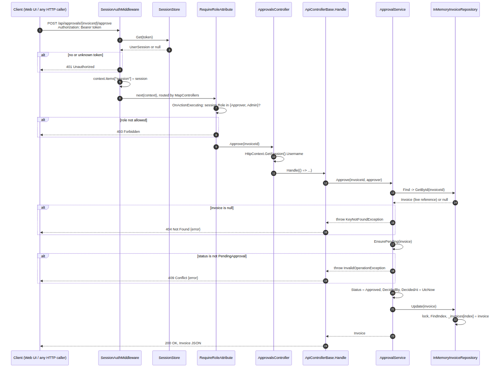
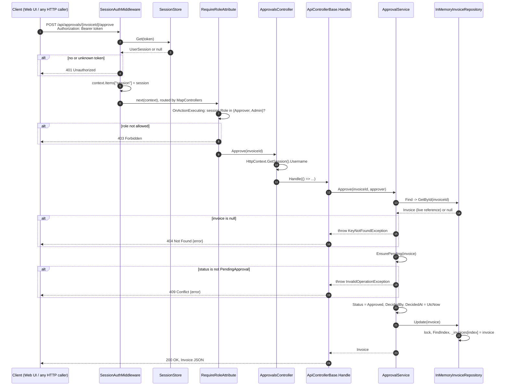

# Sequence: approve an invoice (as built today)

This follows `POST /api/approvals/{invoiceId}/approve` from the HTTP request to the in-memory store, with the failure branches. Nothing under `ops/` is represented. Paths are relative to `backend/src/`.

Rendered with the Mermaid MCP server. Step numbers come from `autonumber` and match the table below.

## Citation for every step

| # | Step | File : line | Class.Method |
|---|---|---|---|
| 1 | Approve button sends POST with Bearer header | `InvoiceApp.Api/wwwroot/app.js:72` → `:82-85` → `:16-19` | click handler → `decide()` → `api()` |
| 1 | Route that receives it | `InvoiceApp.Api/Controllers/ApprovalsController.cs:8,21` | `[Route("api/[controller]")]` + `[HttpPost("{invoiceId}/approve")]` |
| 1 | Middleware order (static files, then session middleware, then controllers) | `InvoiceApp.Api/Program.cs:19-22` | top-level `app.Use…` / `MapControllers` |
| 2 | Read the token and look it up | `InvoiceApp.Api/Auth/SessionAuthMiddleware.cs:23-25` | `SessionAuthMiddleware.InvokeAsync` |
| 3 | Return the session or null | `InvoiceApp.Api/Auth/SessionStore.cs:18-19` | `SessionStore.Get` |
| 4 | 401 when there is no session | `InvoiceApp.Api/Auth/SessionAuthMiddleware.cs:27-30` | `SessionAuthMiddleware.InvokeAsync` |
| 5 | Put the session in `HttpContext.Items` | `InvoiceApp.Api/Auth/SessionAuthMiddleware.cs:33` | `SessionAuthMiddleware.InvokeAsync` |
| 6 | Call the next step (MVC pipeline) | `InvoiceApp.Api/Auth/SessionAuthMiddleware.cs:36`, `Program.cs:22` | `InvokeAsync` → `MapControllers` |
| 7 | Role check | `InvoiceApp.Api/Auth/RequireRoleAttribute.cs:17-21`, applied at `ApprovalsController.cs:9` | `RequireRoleAttribute.OnActionExecuting` |
| 8 | 403 when the role is not allowed | `InvoiceApp.Api/Auth/RequireRoleAttribute.cs:23` | `RequireRoleAttribute.OnActionExecuting` |
| 9 | Run the action | `InvoiceApp.Api/Controllers/ApprovalsController.cs:21-22` | `ApprovalsController.Approve` |
| 10 | Get the approver's username from the session | `ApprovalsController.cs:23`, `Auth/SessionAuthMiddleware.cs:44-45` | `HttpContextExtensions.GetSession` |
| 11 | Wrap the call so errors map to status codes | `ApprovalsController.cs:23`, `Controllers/ApiControllerBase.cs:9` | `ApiControllerBase.Handle` |
| 12 | Call the domain service | `Controllers/ApiControllerBase.cs:13`, `InvoiceApp.Domain/ApprovalService.cs:31` | `ApprovalService.Approve` |
| 13 | Look up the invoice | `InvoiceApp.Domain/ApprovalService.cs:33,61-62`, `InvoiceApp.Api/InMemoryInvoiceRepository.cs:25-27` | `ApprovalService.Find` → `InMemoryInvoiceRepository.GetById` |
| 14 | Return the stored object or null | `InvoiceApp.Api/InMemoryInvoiceRepository.cs:27` | `InMemoryInvoiceRepository.GetById` |
| 15 | Throw when not found | `InvoiceApp.Domain/ApprovalService.cs:63` | `ApprovalService.Find` |
| 16 | Map to 404 | `Controllers/ApiControllerBase.cs:15-17` | `ApiControllerBase.Handle` |
| 17 | Check the invoice is pending | `InvoiceApp.Domain/ApprovalService.cs:34,65-67` | `ApprovalService.EnsurePending` |
| 18 | Throw when it is not pending | `InvoiceApp.Domain/ApprovalService.cs:69-70` | `ApprovalService.EnsurePending` |
| 19 | Map to 409 | `Controllers/ApiControllerBase.cs:19-21` | `ApiControllerBase.Handle` |
| 20 | Set status, approver and time | `InvoiceApp.Domain/ApprovalService.cs:36-38` | `ApprovalService.Approve` |
| 21 | Save | `InvoiceApp.Domain/ApprovalService.cs:39`, `InvoiceApp.Api/InMemoryInvoiceRepository.cs:50` | `IInvoiceRepository.Update` → `InMemoryInvoiceRepository.Update` |
| 22 | Replace the item under the lock | `InvoiceApp.Api/InMemoryInvoiceRepository.cs:52-55` | `InMemoryInvoiceRepository.Update` |
| 23 | Return the invoice | `InvoiceApp.Domain/ApprovalService.cs:40` | `ApprovalService.Approve` |
| 24 | 200 with the invoice; status written as a string | `Controllers/ApiControllerBase.cs:13`, `Program.cs:10` | `ApiControllerBase.Handle` (`Ok`), `JsonStringEnumConverter` |

## Inferred, with no direct citation

- **Order of 401 and 403.** The session middleware runs before routing hands off to MVC filters. That comes from `Program.cs:21-22` together with how ASP.NET Core orders middleware and filters, not from anything in this repo.
- **The 400 branch can't happen on approve.** `Handle` catches `ArgumentException` (`ApiControllerBase.cs:23`), but `Approve` never throws one. Only `Reject` does, when the reason is blank, so the diagram leaves 400 out.
- **The change happens before `Update`.** `GetById` hands back the live object from the list, not a copy, so steps 20 and 22 change the same object. The status is effectively written at step 20, outside the lock, and `Update` puts the same reference back. Two approvals at once could both pass `EnsurePending`. This follows from reading the code; no test covers it.
- **`ApprovalService` is created per request.** It is registered as scoped at `Program.cs:15`, and the framework injects it into `ApprovalsController`. The diagram doesn't show the DI step.
- **Not shown:** after a 2xx response, the UI's `decide()` calls `refresh()` (`app.js:86`) and reloads the list with `GET /api/invoices`. That is a separate request.
