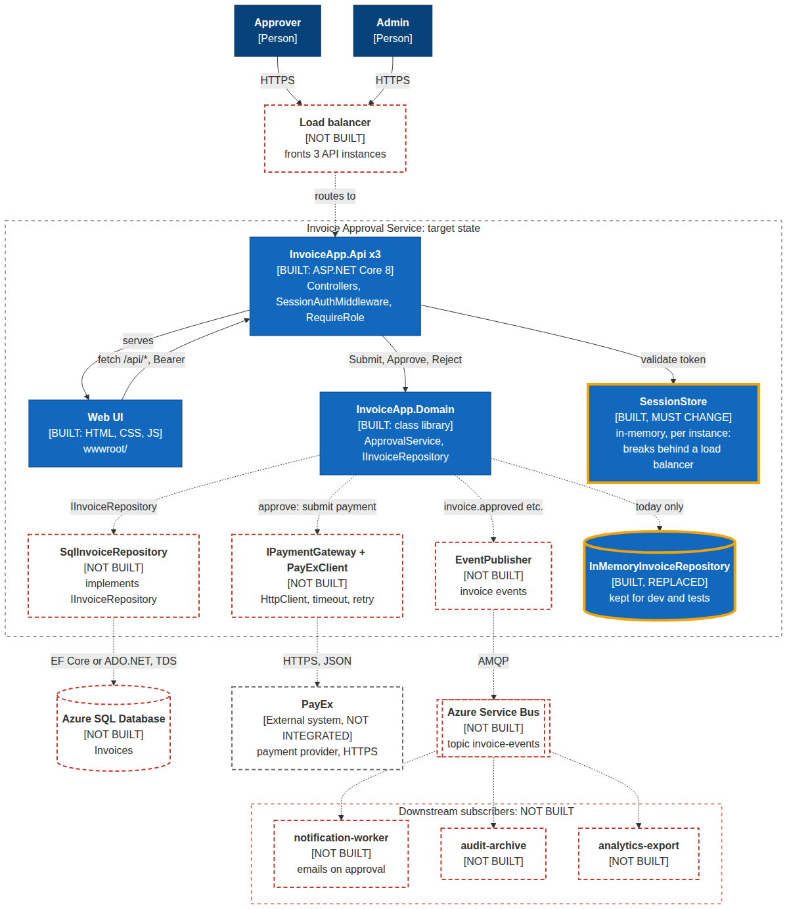
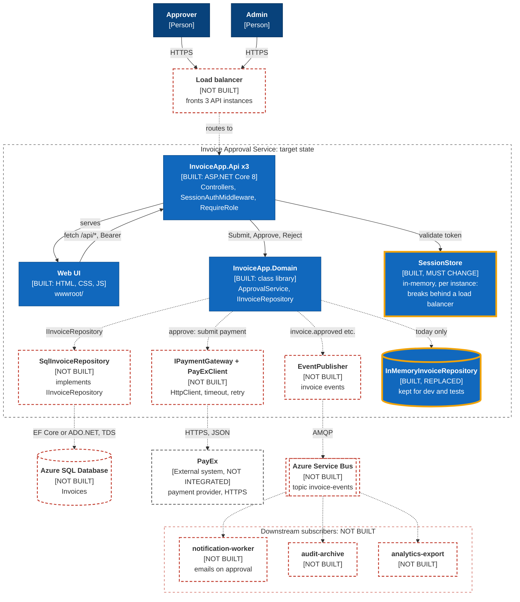

# C4 container diagram: target state (Azure SQL + PayEx)

**This is a plan, not a description of the running system.** For what exists today, see [c4-container.md](c4-container.md).

**Legend**

| Style | Meaning |
|---|---|
| Solid blue | Built today. Same as the as-built diagram |
| Solid blue with **orange border** | Built today, but must change or be replaced before the target state works |
| **Dashed red border, `[NOT BUILT]`** | Does not exist in the code |
| Dashed grey border | External system with no integration yet |
| Dotted arrow | The relationship doesn't exist yet |

Rendered with the Mermaid MCP server.

## Where each element comes from

Built elements are cited from the code, the same as in [c4-container.md](c4-container.md). Planned elements are cited from `ops/`. Under AGENTS.md, that folder describes the planned production deployment and not current behaviour, which is exactly why it's the right source for a target state.

| Element | Status | Source |
|---|---|---|
| Web UI, InvoiceApp.Api, InvoiceApp.Domain | Built | `backend/src/InvoiceApp.Api/`, `backend/src/InvoiceApp.Domain/` (see as-built doc) |
| SessionStore | Built, must change | `Auth/SessionStore.cs` holds sessions in a `ConcurrentDictionary`, registered as a singleton at `Program.cs:13`. Must change because of the three-instance row below |
| InMemoryInvoiceRepository | Built, to be replaced | `InMemoryInvoiceRepository.cs`, `Program.cs:14` |
| Three API instances behind a load balancer | Not built | `ops/incidents/INC-2041/README.md:32` |
| Azure SQL Database | Not built | **Your request.** `ops/README.md:17` only says "a database" and names no product |
| SqlInvoiceRepository | Not built | Name inferred. AGENTS.md rule: "Repositories are interfaces in Domain with an in-memory implementation in Api"; the interface is `IInvoiceRepository.cs` |
| PayEx (external) | Not integrated | `ops/README.md:17-18`, `ops/incidents/INC-2041/README.md:30-31` ("calls it over HTTPS") |
| PayExClient: HttpClient, timeout, retry | Not built | `ops/incidents/INC-2041/deploy-diff.patch:114-117` (typed `AddHttpClient<IPayExClient, PayExClient>`, base URL, 10 s timeout: the pre-2.14.0 registration, which that diff *removes*), `:136` (config), `ops/incidents/INC-2047/recent-changes.md:7` (retry policy) |
| Azure Service Bus topic `invoice-events` | Not built | `ops/incidents/INC-2047/servicebus-status.txt:5` (`az servicebus topic show … sb-invoice-prod --name invoice-events`) |
| EventPublisher | Not built | `ops/incidents/INC-2047/publisher-logs.txt:2` (`Component: EventPublisher`) |
| Event names `invoice.approved` | Not built | `ops/incidents/INC-2047/recent-changes.md:15,24`, `servicebus-status.txt:59` |
| notification-worker, analytics-export, audit-archive | Not built | `ops/incidents/INC-2047/servicebus-status.txt:12-17` (subscription list), `worker-logs.txt:2,6` |

## Inferred, with no direct citation

- **PayEx goes behind a Domain port (`IPaymentGateway`), not in the controller.** The `ops` diff calls `_payEx.SubmitAsync` from `ApprovalsController.Approve` (`deploy-diff.patch:85`). AGENTS.md forbids business logic in controllers, so I drew a Domain interface with the PayEx adapter in Api, the same pattern as `IInvoiceRepository`. The interface name is mine.
- **The order of approve, pay and publish isn't decided.** The `ops` diff saves the approval first and then calls PayEx synchronously (`deploy-diff.patch:84-85`), and INC-2041 is "approvals slow and failing" after that change. Whether payment is sync or async, and whether to use an outbox so that saving to the database and publishing to the topic either both happen or neither does, are open decisions. The diagram doesn't settle them.
- **Sessions must be shared or stateless.** With three instances, a token issued by one instance is unknown to the others. That follows from `SessionStore` being an in-memory singleton combined with INC-2041:32. The fix isn't chosen: Redis, SQL, signed JWTs, or sticky sessions.
- **Demo users in `appsettings.json` would also need replacing** for production, with real identity and secrets. Not drawn, because `ops/` doesn't name a provider.
- **A secrets store (e.g. Key Vault) for the PayEx key and the SQL connection.** Implied by "Rotated the PayEx API key" (`recent-changes.md:33`), but no store is named, so it isn't drawn.
- **Data access technology:** "EF Core or ADO.NET" is a placeholder; nothing chooses it.
- **The legacy notification endpoint** (`deploy-diff.patch:135`, `Notifications.LegacyEndpoint`) is left out because its role relative to the worker is unclear.
- **Incident details aren't architecture.** Everything in `ops/` is invented scenario data (`ops/README.md:22-23`). Instance counts, host names and subscriber names show intent, not a confirmed design.
