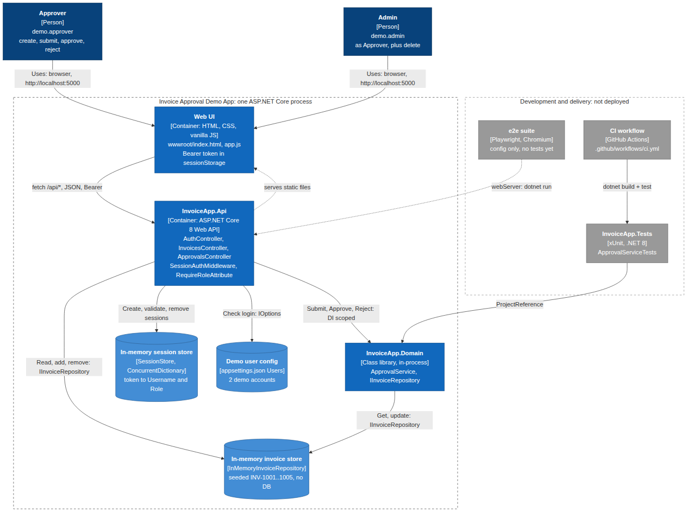
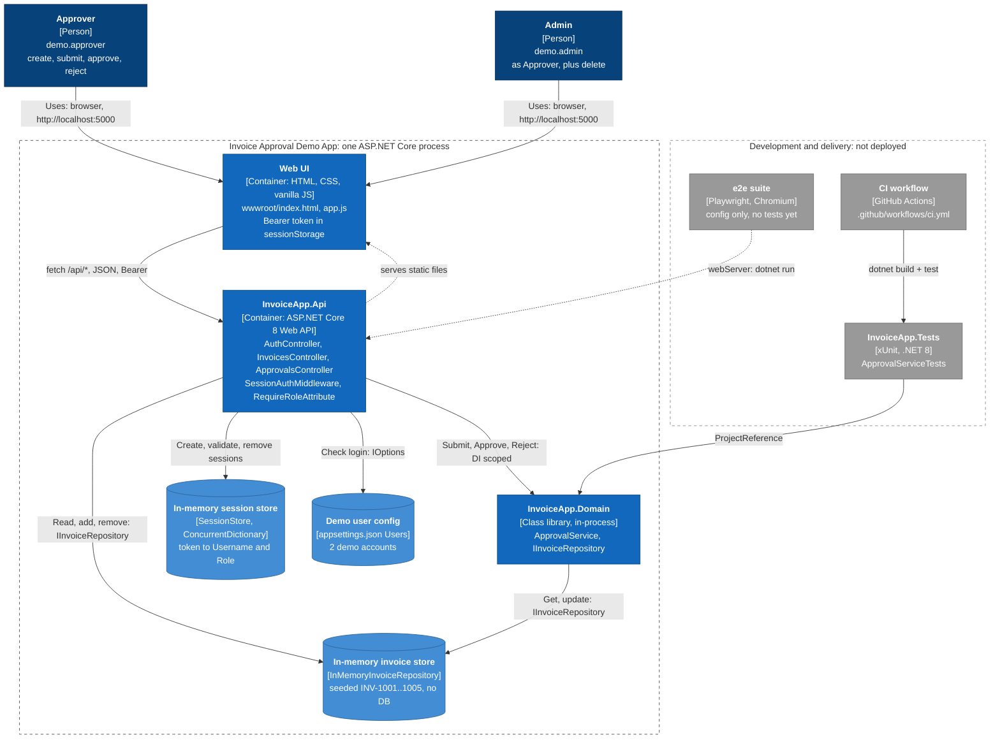

# C4 container diagram: as built today

Scope: the code in this repository as it exists now. Nothing under `ops/` is
represented, so there is no database, message topic or PayEx integration.

Rendered with the Mermaid MCP server. Mermaid's native `C4Container` layout put edge labels on top of each other, so this version is a flowchart styled in C4 colours. Blue is runtime and grey is dev or CI only.

## Sources for each element

| Element | Source |
| --- | --- |
| Approver, Admin (people) | `backend/src/InvoiceApp.Api/appsettings.json` lines 9-12 (`Users`). Role rules: `Controllers/ApprovalsController.cs:9` `[RequireRole("Approver", "Admin")]`, `Controllers/InvoicesController.cs:73` `[RequireRole("Admin")]` on `Delete` |
| Web UI | `backend/src/InvoiceApp.Api/wwwroot/index.html`, `wwwroot/app.js`, `wwwroot/styles.css`. `fetch('/api…')` with Bearer header at `app.js:16-23` (`api()` helper). sessionStorage at `app.js:4,108` |
| InvoiceApp.Api | `backend/src/InvoiceApp.Api/InvoiceApp.Api.csproj` (`Microsoft.NET.Sdk.Web`, `net8.0`). `Program.cs` |
| Endpoints | `Controllers/AuthController.cs` (`api/auth/login`, `logout`), `Controllers/InvoicesController.cs` (`api/invoices` GET, GET {id}, POST, POST {id}/submit, DELETE {id}), `Controllers/ApprovalsController.cs` (`api/approvals/{id}/approve`, `/reject`). Error mapping: `Controllers/ApiControllerBase.cs` |
| Auth middleware and filter | `Auth/SessionAuthMiddleware.cs` (`Program.cs:21`), `Auth/RequireRoleAttribute.cs` |
| InvoiceApp.Domain | `backend/src/InvoiceApp.Domain/InvoiceApp.Domain.csproj`. `ApprovalService.cs`, `IInvoiceRepository.cs`, `Invoice.cs`, `InvoiceStatus.cs`. Referenced by `InvoiceApp.Api.csproj:8` |
| In-memory invoice store | `backend/src/InvoiceApp.Api/InMemoryInvoiceRepository.cs`. Registered as singleton at `Program.cs:14` |
| In-memory session store | `backend/src/InvoiceApp.Api/Auth/SessionStore.cs`. Registered as singleton at `Program.cs:13` |
| Demo user config | `appsettings.json:9-12`, bound by `Program.cs:12` to `DemoUsersOptions` (`Auth/UserSession.cs:12-15`), read in `AuthController.cs:26-27` |
| InvoiceApp.Tests | `backend/tests/InvoiceApp.Tests/InvoiceApp.Tests.csproj` (xUnit 2.9.2, references Domain only), `ApprovalServiceTests.cs`, `FakeInvoiceRepository.cs` |
| e2e suite | `e2e/package.json`, `e2e/playwright.config.ts` (`baseURL` and `webServer.command` at lines 9 and 14). `e2e/tests/` and `e2e/pages/` contain only `.gitkeep`, so the edge is drawn dashed (configured, not exercised) |
| CI workflow | `.github/workflows/ci.yml:17-18` |
| `localhost:5000`, plain HTTP | `Properties/launchSettings.json:6` |

## Inferred, with no direct citation

- **No external systems.** This comes from what is missing. Nothing in `backend/` uses `HttpClient`, a `DbContext`, a message bus or any PayEx client, and no NuGet packages appear outside the test project. The diagram shows no external systems for that reason.
- **Domain shown as its own box.** C4 strictly treats a class library as a component, not a container. It's drawn separately here to show the project boundary. It runs inside the API process.
- **In-memory stores shown as data stores.** They are in-process objects, not separately deployed containers. They're drawn as data stores so the state is visible.
- **State is lost on restart, and there is one instance only.** This follows from the singleton in-memory stores. No file says it outright.
- **Same-origin calls, so no CORS needed.** The UI uses relative `/api` paths and `Program.cs` has no CORS setup.
- **Persona permissions.** "Either role can create and submit" is inferred because `InvoicesController` has no class-level `RequireRole`. Its only check is the session middleware.
- **CI does not run e2e.** This comes from what `ci.yml` leaves out. There are no Playwright steps.
- **Not drawn:**
  - `DiscountCalculator` (`InvoiceApp.Domain/DiscountCalculator.cs`) exists but nothing references it.
  - The Playwright MCP server in `.mcp.json` is developer and agent tooling, not part of the system.
